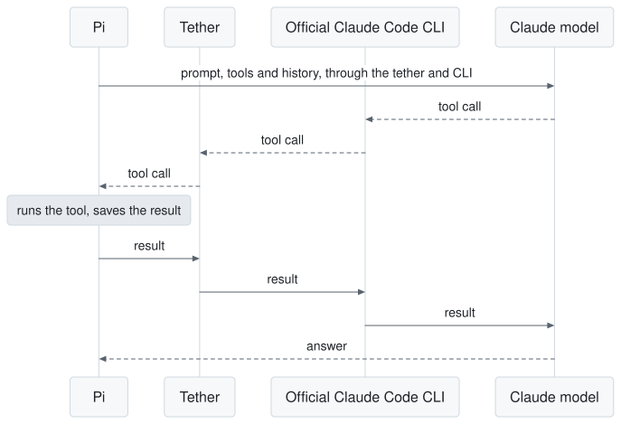

# pi-claude-tether

Use your Claude subscription in [Pi](https://github.com/earendil-works/pi), through the official Claude Code CLI.

Hi, I do most of my work in Pi and I have a Claude subscription. While Anthropic has not been magnanimous enough to let us use our subscription directly in third-party harnesses, it still allows its usage through [`claude -p`](https://support.claude.com/en/articles/15036540-use-the-claude-agent-sdk-with-your-claude-plan), in its installed coding agent CLI. Pi is my main harness and I don't want to be swapping coding agents, and most importantly I don't want to juggle identities and system prompts. The goal of this tether is to unlock the high limits a subscription allows while using your own Pi custom prompt as much as possible, staying lighter on the system prompt than the less-than-optimal vendor harnesses, and not having to go through the API. I wrote it with a coding agent.

<picture>
  <source media="(prefers-color-scheme: dark)" srcset="assets/flow-dark.svg">
  
</picture>

## Who it's for

This is for you if you've built your workflow around Pi and you have a Claude plan. Claude models appear in `/model`, and you can move between them and other providers within one session. Pi's skills, hooks and extensions keep working.

## Install

You need Node 22 or newer and Claude Code 2.1.263 or newer. Opus 5.5 needs 2.1.280. I tested this with Pi 1.5.0.

```sh
pi install npm:pi-claude-tether
CLAUDE_CONFIG_DIR="$HOME/.local/share/pi-claude-tether/claude-config" claude auth login --claudeai
```

The tether reads that folder by default, so this login stays separate from any Claude Code you use yourself. If it worked, Claude models appear under `pi-claude-tether` in `/model`. Version 0.12.0 uses the new provider identity without an alias; see the [migration checklist](CHANGELOG.md#0120-migration).

## How it works

The tether runs the official Claude Code CLI and keeps one process alive per session and account, so follow-up turns and tool calls stay on the same process. Pi's system prompt replaces the Claude Code one, every tool runs in Pi, and Pi owns the history. Your login stays in the CLI, and the tether never reads it.

For several Claude accounts, use `/claude-accounts` inside Pi to add, switch and turn on failover. It saves everything in `~/.pi/agent/pi-claude-tether.json`, so no shell setup is needed. [Where settings live](docs/DETAILS.md#where-settings-live) explains the optional environment variables.

In short live tests on Sonnet 5.5, 98.3% of a warm turn's input came from the cache on one machine and 99.1% on another. I haven't published a comparison with the direct API yet.

## Why not something else

| Option                                                                                 | Why I didn't use it                                                                                                                                                      |
| -------------------------------------------------------------------------------------- | ------------------------------------------------------------------------------------------------------------------------------------------------------------------------ |
| Pi with the direct API                                                                 | It works well, but you pay per token instead of using your plan.                                                                                                         |
| Packages that reuse your Claude login and imitate Claude Code                          | I don't want my account depending on imitating a client. Those packages also have to keep up each time the client changes.                                               |
| [pi-claude-bridge](https://github.com/elidickinson/pi-claude-bridge), on the Agent SDK | It's a good official route and Pi runs the tools there too. I went with the CLI because this project started as a fork of pi-claude-cli.                                 |
| [pi-claude-cli](https://github.com/rchern/pi-claude-cli)                               | This is where the project started. I forked it to add cache continuity across cancelled tools, retries and steering, several accounts, and a safe way to update the CLI. |

## When not to use it

- You restart Pi often in long sessions. When the process restarts, the tether imports the history as text and the cache can go cold.
- You're short on memory. Each parked session keeps a Claude process in memory.
- You expect to run into usage credits. A turn billed to credits fails, unless you set `PI_CLAUDE_TETHER_ALLOW_USAGE_CREDITS=1`.
- You want several accounts without reading the rules. The tether supports them, but check Anthropic's terms first.
- Your tools run for a very long time. The tether waits 30 minutes for a tool by default, then stops that Claude process, and the next turn imports the history again. A real 33-minute tool survived this and answered after reimport; past about 30 minutes the CLI itself also ends its waiting turn, so expect a reimport either way. See "Long tools" in [docs/DETAILS.md](docs/DETAILS.md).
- You need Pi's `onProviderStreamEvent` hook. The Claude CLI doesn't expose the raw stream, so the tether can't call it. The other provider hooks work.
- You run it in a restricted sandbox and don't want to open anything up. It needs a short writable folder for its sockets, plus the Claude profile and state folders. If one is missing, the error tells you which.

## More

This started as a fork of [pi-claude-cli](https://github.com/rchern/pi-claude-cli) through [Agustín Sacco's fork](https://github.com/agustinsacco/pi-claude-cli), and I'm grateful to Rebecca Chernoff and Agustín for their work. It's an independent project, and Anthropic didn't make it. The technical details are in [docs/DETAILS.md](docs/DETAILS.md). Please report problems in the [issues](https://github.com/kyraneth/pi-claude-tether/issues). [MIT license](LICENSE).
